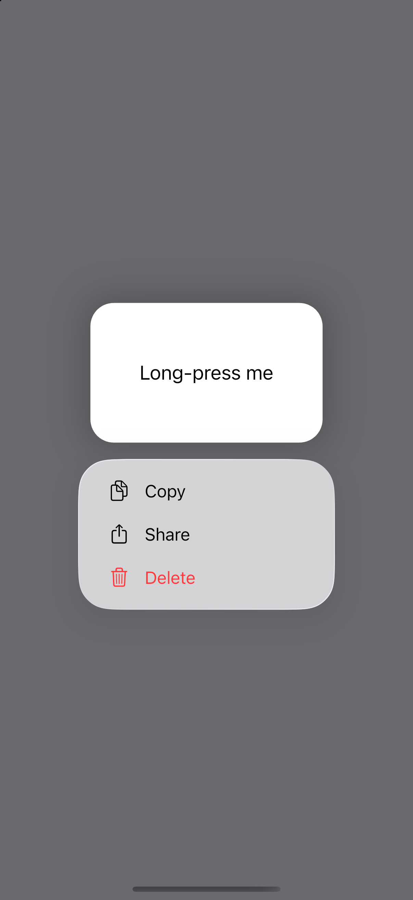
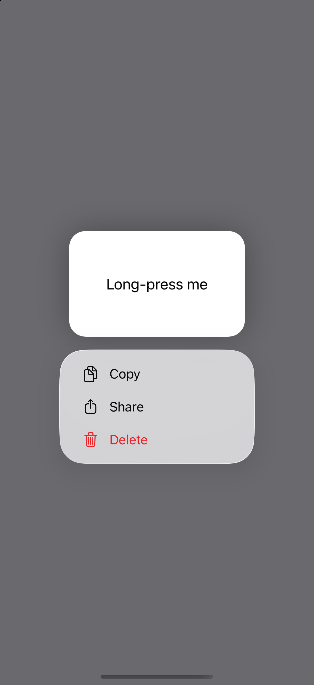
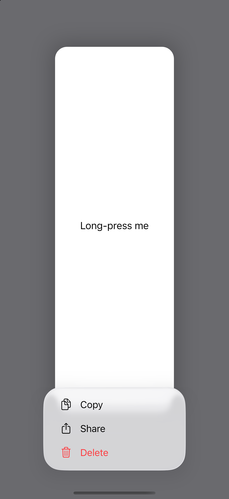

# Context menu parity on iOS 26.4

The captures below use the example app's `contextmenuuikit` reference scene.
The menu is 250 pt wide, with a 16 pt gap below the standard lifted
preview. The page behind it dims and stays sharp. The preview casts a
soft shadow, and the edge scenes show UIKit keeps it 20 pt inside the
vertical safe area (no edge-scene capture is saved in `images/`; see
`controls.json`). The measurements are recorded in
[`controls.json`](../../../tool/reference/controls.json).

| Flutter | UIKit |
| --- | --- |
|  |  |

The standard preview captures are shown above. Both use the same 250 pt menu.
The earlier Flutter open palette-menu capture clipped at the right screen
edge. The twin now opens with `GlassMenuPlacement.centred`, and the refreshed
light and dark captures fit within the viewport
([light Flutter](images/palette-menu-open-flutter.png) /
[SwiftUI](images/palette-menu-open-swiftui.png),
[dark Flutter](images/palette-menu-open-dark-flutter.png) /
[SwiftUI](images/palette-menu-open-dark-swiftui.png)). On iPhone, the popover pair
([Flutter](images/popover-iphone-flutter.png) /
[SwiftUI](images/popover-iphone-swiftui.png)) keeps the page background at
RGB 128 in both captures, confirming it remains undimmed.

For a 600 pt preview UIKit reduces the lift scale and overlaps the menu
with the preview so the menu stays above the bottom safe area. This
capture informed the Flutter sizing and placement. The refreshed tall-preview
pair is below.

| Flutter tall preview | UIKit tall preview |
| --- | --- |
|  |  |
